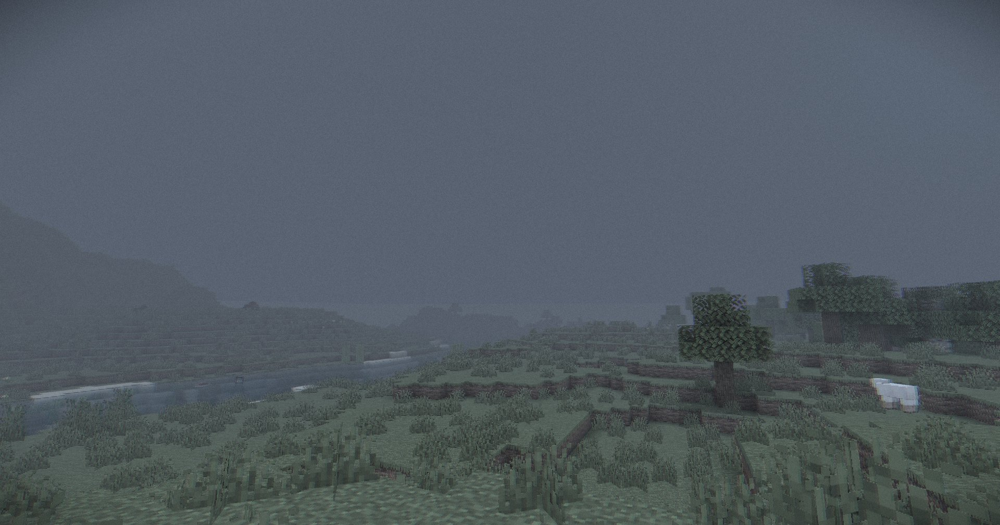
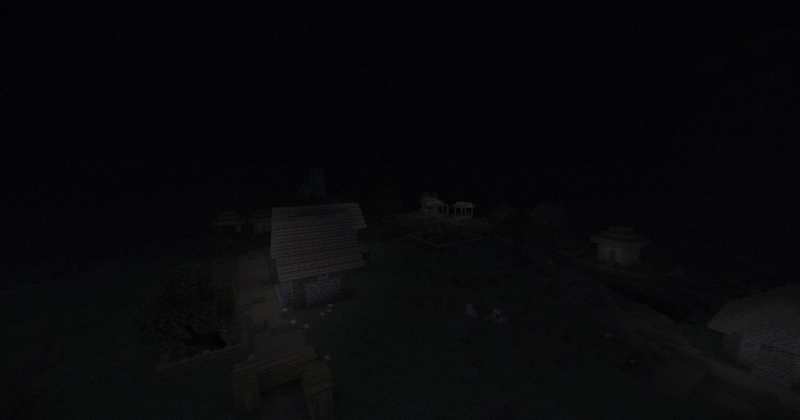

# my-world-shader

> 「悪夢の世界のような、陰鬱で静かな空気を生み出す」Minecraft用GLSLシェーダーパック。

**日本語** | [**English**](README.md)

---

## ギャラリー (Gallery)

*昼: 煙雨に覆われた冷淡な平原と、静かに流れる濁ったターコイズブルーの川*

*夜: 光が呑み込まれる深淵の闇と、暗闇に溶け込む水面*

---

## 概要 (Overview)
`my-world-shader` は、鮮やかで眩しい一般的な影MODの対極に位置する、心理的圧迫感と静寂を追求した独自のシェーダーパックです。
生気を奪い去る彩度低下、光を吸い込むような冷たい鈍色の雨霧、視界の四隅を侵食する周辺減光、そして微細に蠢くフィルムグレインによって、見慣れた立方体の世界を不穏で静謐な悪夢の領域へと変貌させます。

---

## 主な特徴 (Features)

### 1. 陰影・光学表現 (Lighting & Shadows)
- **Solas方式スクリーン空間シャドウ (Screen Space Shadows / SSS)**:
  - 太陽光のベクトルに向かって画面深度をリアルタイムにレイマーチングし、自然で正確な影を描画。シャドウマップ特有の歪みやカスケード境界の破綻を根絶。
  - 一人称視点で見下ろした際の手・腕による切断影を幾何学的に除外。
- **リアルかつ不穏な陰影表現 (Directional Shadows & SSAO)**:
  - 深度バッファから復元した法線ベクトルに基づき、太陽・月の方向から落ちる冷たく鋭い陰影。
  - **SSAO (Screen Space Ambient Occlusion)** による、ブロックの角や隙間、接地面に落ちる濃密な暗影。
- **煙霧を貫く冷たい薄明光線 (Atmospheric Crepuscular Rays / God Rays)**:
  - 太陽光が遮蔽物の隙間から煙雨を切り裂いて差し込む、静謐な光条。
- **手持ち光源システム (Dynamic Handheld Light)**:
  - 松明などの光源を手に持った際、プレイヤー周囲を温かく照らし出す動的ライティング。

### 2. 水面・水中表現 (Realistic Water & Abyss Fog)
- **濁ったターコイズブルーのリアル水面**:
  - Beer-Lambert則に基づく水深別の光吸収（赤色光の優先的減衰）とフレネル反射、微細な有機的波紋。
  - 昼夜サイクルに完全連動し、夜間は周囲の闇に自然に溶け込む夜の水面へと移行（不自然な白浮き・蛍光発光を完全防止）。
- **深淵の水中フォグ & 吸光**:
  - 水中侵入時の視覚的露出暗化と、至近距離（1m）から立ち上がる暗黒ターコイズフォグによる深海の静寂と閉塞感。

### 3. 自発光ブロック表現 (Emissive Blocks)
- **重厚で自然な赤黒い溶岩 (Boiling Dark-Crimson Lava)**:
  - 外部の影や夜間脱色の影響を受けない自発光システム。
  - バニラの溶岩テクスチャとアニメーションの質感を活かしつつ深紅トーンへ変換。冷え固まった地殻と高温の割れ目が、世界座標連動で静かに煮え滾る熱の息づかいを再現。

### 4. 悪夢的ポストプロセス (Nightmarish Post-Processing)
- **彩度低下 & 寒色カラーグレーディング (Desaturation & Cold Tint)**:
  - 鮮烈な色彩を抑え、冷淡な鉛色と青灰色のトーンへと収束。
- **陰鬱たる鈍色の雨煙・指数関数フォグ (Gloomy Rain Fog)**:
  - 遠景を閉ざす指数関数フォグと、時間経過に伴って漂う有機的なミストの揺らぎ。天候（雨・雷雨）と連動する動的濃度変化。
- **微細な色収差 (Chromatic Aberration) & 周辺減光 (Vignette)**:
  - 画面周辺部に向かって光線の波長をわずかに乖離させ、四隅を濃い暗黒で締め付ける閉塞感。
- **蠢くフィルムグレイン & 脈動 (Dynamic Grain & Breathing Pulse)**:
  - アナログ映画フィルムのような微細ノイズと、世界が呼吸しているかのような極小の明滅。

---

## 動作要件 (Requirements)
- **Minecraft: Java Edition**: 1.21.1
- **シェーダーローダー**: [Iris Shaders](https://modrinth.com/mod/iris) (v1.8.14以降推奨)
- **描画最適化**: [Sodium](https://modrinth.com/mod/sodium) (v0.8.13以降推奨)

---

## インストール方法 (Installation)
1. 上記の動作要件（Fabric + Iris + Sodium）を導入します。
2. 本リポジトリの [Releases](../../releases) から最新の `my-world-shader.zip` をダウンロードします。
3. Minecraft の `shaderpacks` フォルダに zip ファイルを配置します。
4. ゲーム内の「ビデオ設定」→「シェーダーパック」から `my-world-shader` を選択します。

---

## 開発・ホットリロード (Development)
本リポジトリは Minecraft の `shaderpacks` フォルダとジャンクション結合して開発されています。
コード（`shaders/final.fsh` 等）を編集・保存後、ゲーム内で **`F3 + R`** を押すことでリアルタイムに描画結果を更新できます。

---

## ライセンス (License)
本プロジェクトは [MIT License](LICENSE) の下で公開されています。
